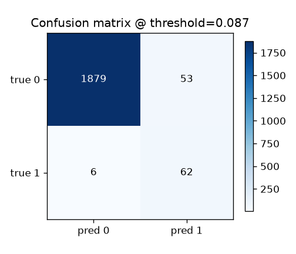
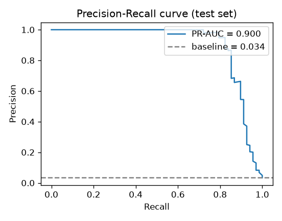
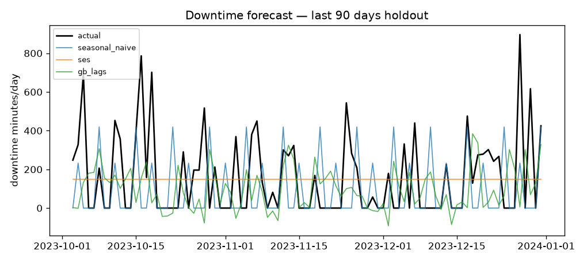
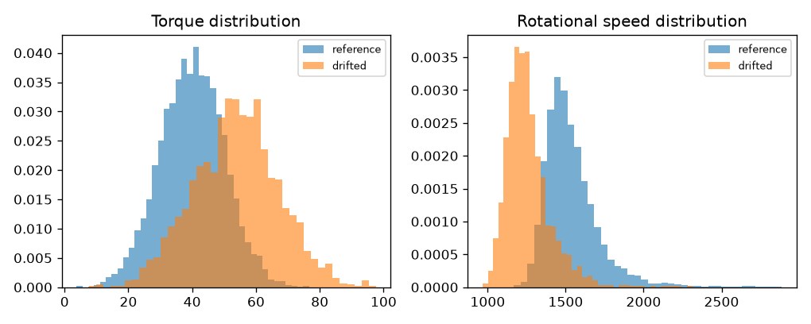

# Evaluation Report

_Generated 2026-11-08T05:33:56.230004+00:00 · tracker backend: **mlflow** · git: `uncommitted`_

## 1. Failure classifier (imbalanced, PR-AUC focus)

| Metric | Value |
|---|---|
| PR-AUC (average precision) | 0.8997 |
| ROC-AUC | 0.9772 |
| Brier score | 0.0074 |
| Baseline PR-AUC (failure rate) | 0.0340 |
| Test rows / positives | 2000 / 68 |

## 2. Cost-sensitive decision policy

Assumed costs: missed failure = **$8,000**, false alarm = **$300** (ratio 27:1).

| Metric | Value |
|---|---|
| Chosen threshold | 0.087 |
| Expected cost @ chosen | $63,900 |
| Expected cost @ 0.5 | $112,600 |
| Savings vs 0.5 | $48,700 |
| Precision @ chosen | 0.5391 |
| Recall @ chosen | 0.9118 |
| F1 @ chosen | 0.6776 |
| TP / FP / FN / TN | 62 / 53 / 6 / 1879 |

## 3. Anomaly detector (IsolationForest, healthy-only train)

| Metric | Value |
|---|---|
| ROC-AUC | 0.8333 |
| PR-AUC | 0.1871 |
| Flag rate | 0.0565 |
| Flag threshold | 0.5730 |

## 4. Downtime forecasting (time-based holdout)

Holdout horizon: **90 days**. SES alpha = 0.041.

| Model | MAE (min) | RMSE (min) | MAPE (%) |
|---|---|---|---|
| naive | 159.79 | 266.16 | 100.00% |
| seasonal_naive | 175.62 | 263.56 | 87.73% |
| ses | 174.17 | 213.09 | 52.45% |
| gb_lags | 185.19 | 250.90 | 79.63% |

**Best by MAE:** `naive`

## 5. Figures

